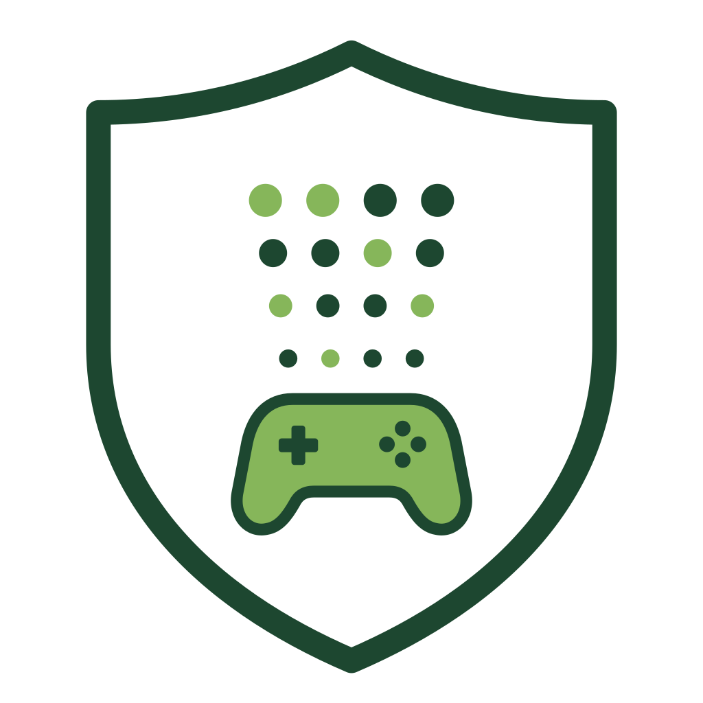

# Open Game Standards: OGS Telemetry Standard (OGS-TS)

<picture>
  <source media="(prefers-color-scheme: dark)" srcset="assets/logo/telemetry-standard-dark.svg">
  
</picture>

The OGS Telemetry Standard (OGS-TS) defines a standardised method and
format for games and simulators to broadcast live telemetry to devices and
software on the user's local area network (LAN).

Community & support: [Discord](https://discord.gg/tseF4Q6U99) · Development is funded by [sponsorship](https://github.com/sponsors/BrianGilbert)

Any number of receivers on the LAN can consume the same stream at once:
motion platforms, haptic vests and transducers, physical cockpit hardware,
dashboards, and performance loggers. A game running on a console or PC can
drive a motion rig, haptics, or instrument panels running on other machines
in the same home — no cloud service, account, or internet connection is
involved.

OGS-TS telemetry stays on the local network. It is not analytics or crash
reporting: the data is broadcast for the user's own equipment to read in
real time, and it never leaves the LAN.

It defines a logical minimal set of required telemetry to meet the standard,
while also allowing developers the flexibility to include additional
telemetry data in a well documented structure and format. It defines the
network protocols and provides tools to aid implementation in multiple game
engines.

## Origin and stewardship

The OGS Telemetry Standard (OGS-TS) was started in 2024 by 
**Brian Gilbert** ([@BrianGilbert](https://github.com/BrianGilbert)).

It is developed in the open under the GitHub organization 
[Open-Game-Standards](https://github.com/Open-Game-Standards). 
That organization is currently an informal community vehicle; 
there is no separate legal entity. Design decisions, validation 
evidence, and the specification itself live in this repository 
and are free for anyone to implement under the MIT license.

Brian remains the primary maintainer. Contributions are welcome 
via pull requests and issues. If the project grows a broader 
maintainer group or a formal organization is later established, 
this section will be updated accordingly.

## Supporting the work

OGS-TS is developed in the open by Brian Gilbert. 
If the standard is useful to you or your products, 
you can support its continued development directly:

- [GitHub Sponsors](https://github.com/sponsors/BrianGilbert)
- [Buy Me a Coffee](https://buymeacoffee.com/itsvrk)

Sponsorship goes to the primary maintainer and helps 
fund ongoing design, validation, reference implementations, 
and community coordination. There is currently no separate 
legal entity or project bank account.

## Logo

The OGS-TS logo is in [assets/logo](assets/logo), as SVG and as 512 px
and 1024 px PNG:

| File | Use on |
| --- | --- |
| `telemetry-standard` | Light backgrounds (transparent) |
| `telemetry-standard-dark` | Dark backgrounds (transparent, light outlines) |
| `telemetry-standard-white` | Anywhere a solid square is needed (white background) |
| `telemetry-standard-dark-black` | Anywhere a solid square is needed (black background), e.g. app and plugin icons |

## Implementation

Building a sender or receiver (any language, any engine — including
custom ones)? Start at [IMPLEMENTING.md](IMPLEMENTING.md) — the
implementer's path, minimum-conformant-sender checklist, corpus
validation, and the fastest routes per engine.

### Reference implementations

Wired and validated engine plugins, maintained as sibling repos:

- [ogs-ts-dotnet](https://github.com/Open-Game-Standards/ogs-ts-dotnet) — engine-agnostic .NET core (`Ogs.Telemetry`); the Unity and Godot plugins wrap it
- [ogs-ts-unity](https://github.com/Open-Game-Standards/ogs-ts-unity)
- [ogs-ts-unreal](https://github.com/Open-Game-Standards/ogs-ts-unreal)
- [ogs-ts-godot](https://github.com/Open-Game-Standards/ogs-ts-godot)

### Tools

- [OGS-TS Monitor](https://github.com/Open-Game-Standards/ogs-ts-monitor) —
  desktop receiver for Windows, Linux and macOS: shows every sender on the
  network (objects, channels, attitude, track, events) and checks each frame
  against this standard, listing anything non-conformant by rule

### Conventions

Frames, quaternion policy, units (SI plus a closed whitelist), rotation
signs, control-input signs, value identity, wind convention, timestamps,
and precision are defined once in [CONVENTIONS.md](CONVENTIONS.md) — every
field comment and channel family cites its clauses. Is positive steering
left or right, radians or degrees, handwheel or road wheel: the answer is
one lookup, not per-field folklore.

### Events and non-motion consumers

An `EventFrame` carries discrete stimuli (impacts, gunfire, footsteps) for
haptic vests, transducers, and cueing effects, with redundancy over the
lossy transport via short replay + id dedup (CONVENTIONS C-10). Motion
rigs, haptics, FFB middleware, dashboards, and loggers are all first-class
consumers — see DESIGN.md, Consumer classes.

### Data format

We propose using Cap'n Proto as the data format. Cap’n Proto is a zero-copy, binary serialization format optimized for speed and efficiency, making it an excellent choice for sending motion telemetry data over UDP. It avoids encoding/decoding overhead by using a memory-aligned layout, and it supports optional fields and nested structures efficiently.

[Implementation details for Cap'n Proto data format](implementation-capnproto.md).

### Data Transport

The data transport is plain UDP multicast — one socket, no broker, no driver
process — with an 8-byte envelope identifying the frame type. Multiple local
clients (dashboards, motion rigs, haptics, loggers) join the same multicast
group; no extra ports or proxying.

[Implementation details for UDP data transport](implementation-udp.md).

### Sender references

Per-game implementation references: core schema mapping plus sender-declared
channel tables, ready to build against.

- [MSFS 2024 sender reference](reference-msfs2024.md) — the full SimVar set
  (1,354 variables) mapped onto OGS-TS core schema plus channels, with
  conversions, cadences, and large-world precision guidance.
- [iRacing sender reference](reference-iracing.md) — the irsdk set (telemetry
  + session-string YAML) mapped the same way, with multi-car grid guidance
  and capture-verify unit rules.

### Validation

The standard is validated against real sources — 16 tests across 6 source
classes (documented game formats, community memory offsets,
vendor-encapsulated integrations, game-native UDP outputs, injected
providers, consumer documentation), 100+ game outputs, zero open gaps.

[Validation tests and results](validation/README.md).

### Conformance corpus

Golden datagrams + semantic manifest for byte-level encoder agreement
across engine implementations — [conformance/](conformance/).

### Schema (v1, two-layer)

The schema separates static metadata from per-frame samples: a low-rate
`DiscoveryFrame` (environment, drive-point descriptors, self-describing channel
declarations with type/unit/range — the standard's extension mechanism) and a
high-rate `MotionFrame` (the minimal pose core plus typed values keyed by
discovery ids). See [DESIGN.md](DESIGN.md),
[`ogs_telemetry.capnp`](ogs_telemetry.capnp), and the
[Common Channels annex](CHANNELS.md) for ratified cross-game channel names
and units.

## Scope

The scope of the OGS-TS encompasses the following key areas:

### Telemetry Transmission

The OGS-TS defines common methodologies and protocols for transmitting a wide range of telemetry data to local software/hardware to provide expanded abilities for:

    - Motion Simulation
    - Haptics and Feedback
    - Performance logging, tracking and reporting tools

### Data Formatting

The OGS-TS establishes standardized formats and schemas for organizing and structuring telemetry data, ensuring consistency and compatibility across different gaming platforms, devices, and software systems.

### Data Transmission

The OGS-TS specifies standardized communication protocols and APIs for transmitting telemetry data to devices and software on the user's local area network (LAN).

## What the OGS-TS Does Not Cover

While the OGS-TS aims to provide a comprehensive framework for local telemetry transmission in the gaming industry, it does not cover the following areas:

### Game Content

The OGS-TS does not dictate or regulate the content, design, or gameplay features of individual games. It focuses solely on the formatting, and transmission of telemetry data for devices and software on the user's local area network (LAN).

### Hardware Specifications

The OGS-TS does not prescribe specific hardware requirements or standards for gaming devices or platforms. It is platform-agnostic and designed to be compatible with a wide range of hardware configurations and operating environments.

### Business Models

The OGS-TS does not dictate or influence the business models, pricing strategies, or monetization methods adopted by game developers, publishers, or platform providers. It focuses exclusively on technical standards and practices related to telemetry data management.

## Requirements

- Data structure must be easily understandable
- Protocol must support multiple clients without the need for opening additional ports or proxying
- Must be implementable in both console and PC context
- Must allow structured addition of extra telemetry datapoints

## Constraints and limitations

- Must be network efficient
- Must have low latency at all areas of implementation
- Does not allow update of data within game (read-only — see [DESIGN.md](DESIGN.md), Non-goals)

## Examples and Scenarios

1. User plays game on a console, uses PC with motion control software to control a motion simulator and haptics devices using telemetry from the console game.

2. User plays game on PC, has created a realistic physical cockpit matching that of game, uses telemetry data fed into software client that controls the devices on the physical cockpit.

3. User plays game on PC or Console, a software client is able to log performance metrics over multiple sessions and provides a user friendly interface showing user performance and progression over time.

## Decision Points and Trade-offs

With the need to support console devices any implementation method that only works with telemetry client software, or hardware directly running or connected to the device executing the game will not be entertained.
